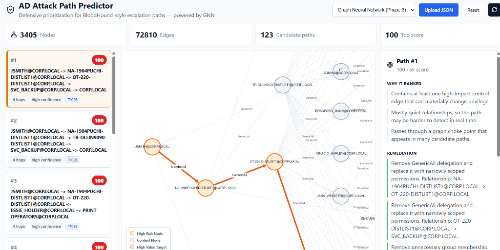
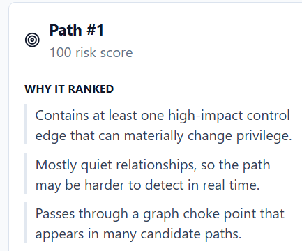
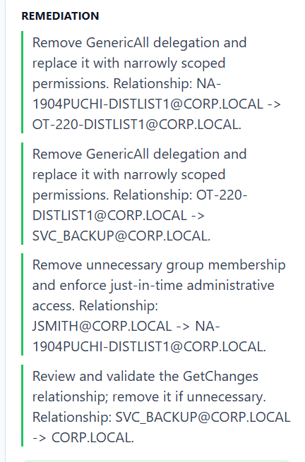
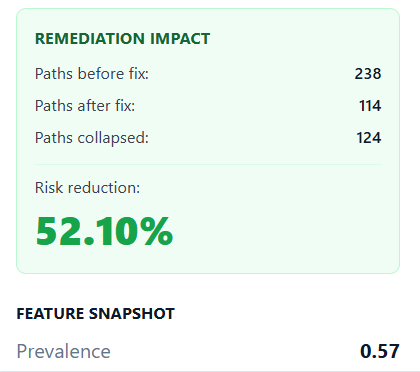

<div align="center">


# 🛡️ GraphHound
### *AD Attack Path Predictor*

**Defensive prioritization for BloodHound-style Active Directory escalation paths — powered by GNN**

*BloodHound shows you everything. GraphHound tells you what to fix first — and how much risk each fix eliminates.*

[](https://python.org)
[](https://pyg.org)
[](https://lightgbm.readthedocs.io)
[](https://fastapi.tiangolo.com)
[](https://react.dev)
[](https://mlflow.org)
[](LICENSE)

</div>

---

## 🔍 What Is This?

GraphHound ingests **BloodHound JSON exports** from Active Directory environments and produces a **ranked, risk-scored shortlist of attack paths** — telling defenders which paths to fix first and quantifying exactly how much attack surface each fix eliminates.

> **The problem with BloodHound alone:** it shows you *all* paths. With hundreds of escalation routes in a real enterprise, knowing which 5 to fix this week is the actual challenge. GraphHound solves that.

**What makes it different from GoodHound / PlumHound:**

| Capability | BloodHound CE | GoodHound | PlumHound | **GraphHound** |
|---|:---:|:---:|:---:|:---:|
| Path enumeration | ✅ | ✅ | ✅ | ✅ |
| Ranking by edge count | — | ✅ | ✅ | ✅ |
| Exploitation likelihood scoring | — | — | — | ✅ |
| ATT&CK technique mapping | — | — | — | ✅ |
| Graph Neural Network ranking | — | — | — | ✅ |
| **Remediation impact simulation** | — | — | — | **✅** |
| "Fix this, collapse X% of surface" | — | — | — | **✅** |

---

## 📸 Screenshots

### Dashboard Overview — 3,405 Nodes · 72,810 Edges · 123 Candidate Paths



*The full GraphHound dashboard: upload a BloodHound JSON, get ranked attack paths visualized in an interactive graph with remediation recommendations on the right.*

---

### Path Ranking — Risk Score Explanation



*Every ranked path includes a transparent explanation: high-impact control edges, detection noise level, and choke-point significance.*

---

### Remediation Panel — Actionable Fixes



*Per-path, specific permission changes — not generic advice. Exact relationships to remove with source and target principals named.*

---

### Remediation Impact — 52.10% Risk Reduction from a Single Fix



*One recommended fix collapsed 124 paths — **52.10% of total attack surface** — in the generalization test on an unseen lab.*

---

## 📊 Key Results

| Metric | Result | Notes |
|---|---|---|
| **Precision@5** | **100%** | Lab 1 — 594 paths, 3,405 nodes |
| **Precision@10** | **100%** | Lab 1 |
| **GNN Recall@20%** | **19.44%** | Unseen dense graph (Lab 2) |
| **LightGBM Recall@20%** | **0%** | Same unseen graph — complete failure |
| **Remediation impact** | **52.10%** | Single fix collapsed 124 / 238 paths |
| **Graph scale** | 3,405 nodes · 72,810 edges | Production-scale BadBlood synthetic AD |

> **Key finding:** The GNN maintains 19.44% Recall@20% on an unseen dense graph where LightGBM completely fails (0%) due to technique homogeneity — empirically proving that **graph structure carries independent signal beyond tabular features**.

---

## 🏗️ Architecture

BloodHound JSON export → graph ingestion → feature extraction → dual-model ranking (LightGBM baseline + GNN) → FastAPI backend → React + Cytoscape.js dashboard with remediation panel.

---

## ⚡ Quick Start

### Prerequisites

- Python 3.10+
- Node.js 18+
- Neo4j (optional — in-memory graph works without it)

### Backend

```powershell
cd ad-attack-path-predictor
python -m venv .venv
.\.venv\Scripts\Activate.ps1
pip install -r requirements.txt

# Rank top paths from a BloodHound export
python -m ad_attack_path_predictor.cli rank --input data\sample_bloodhound.json --top 5

# Start the API server
uvicorn ad_attack_path_predictor.api.main:app --reload --port 8000
```

API docs available at `http://127.0.0.1:8000/docs`

### Dashboard

```powershell
cd dashboard
npm install
npm run dev
```

Dashboard at `http://127.0.0.1:5173` — upload a BloodHound JSON and see ranked results immediately.

---

---

## 📥 Input Format

Accepts standard BloodHound JSON exports from SharpHound or BloodHound CE. See `docs/data_schema.md` for format details.

---

## 🧠 Scoring

Scoring methodology documented in `docs/methodology.md`.

---

---

## 🔬 Methodology

**Why GNN beats flat LightGBM here:**

LightGBM sees each path as an isolated feature vector — it has no awareness that two paths share a common node (e.g., `SVC_BACKUP@CORP.LOCAL` appearing in 40 different paths). The GNN learns node embeddings from the **full graph structure**, capturing "this node is a high-centrality hub that many attack paths route through" as part of the representation itself — not as a hand-engineered feature.

This structural awareness is the genuine technical contribution that explains the GNN's maintained recall on dense graphs where LightGBM collapses.

**Remediation impact simulation:**

For each top-ranked recommendation, the tool simulates removing that edge, re-runs path enumeration, and reports how many candidate paths collapse. This is the capability missing from every comparable open-source tool.

---

## ⚠️ Limitations

- **Dense homogeneous graphs:** GNN Recall@20% drops when technique diversity is very low (all paths use the same 2–3 edge types) — LightGBM and GNN both struggle, but GNN degrades more gracefully.
- **Heuristic labeling:** Ground-truth labels are generated from injected synthetic misconfigurations (BadBlood), not from real breach outcomes. Real-world calibration requires red team validation.
- **Single-domain tested:** Generalization to multi-domain forests and Azure AD / Entra ID hybrid environments is a planned future phase.
- **Collection dependency:** Requires a BloodHound-compatible JSON export — SharpHound, BloodHound CE, or hand-crafted synthetic data.

---

## 🛠️ Tech Stack

| Layer | Technology |
|---|---|
| **Graph DB** | Neo4j · NetworkX |
| **ML — GNN** | PyTorch Geometric · GAT architecture |
| **ML — Baseline** | LightGBM |
| **Experiment Tracking** | MLflow |
| **Backend API** | FastAPI |
| **Frontend** | React · Vite · Cytoscape.js |
| **Lab Data** | BadBlood synthetic AD · Windows Server 2019 Evaluation |
| **ATT&CK Mapping** | MITRE ATT&CK for Enterprise (static JSON reference) |

---

## 🧪 Running Tests

```powershell
pytest tests/ -v
```

The test suite includes sample data so the project runs immediately without a lab environment.

---

## ⚖️ Ethical Use

> **Lab-only. No real organizations targeted.**

This tool was built on:
- Windows Server 2019 Evaluation (lab VM)
- [BadBlood](https://github.com/davidprowe/BadBlood) synthetic Active Directory data
- No production or real-organization data was used at any stage

**Use this tool only when:**
- You own the environment, or have explicit written authorization to analyze it
- Collection data was obtained legally and per organizational policy
- Results are used to reduce risk, improve detection, or support defensive research

See [ETHICS.md](ETHICS.md) for the full responsible use statement.

---

## 🗺️ Development

Active development — contributions welcome.

---

## 📄 License

MIT — see [LICENSE](LICENSE) for details.

---

<div align="center">

**Built for defenders, by a defender.**

*If you find this useful, star the repo — it helps others discover it.*

</div>
